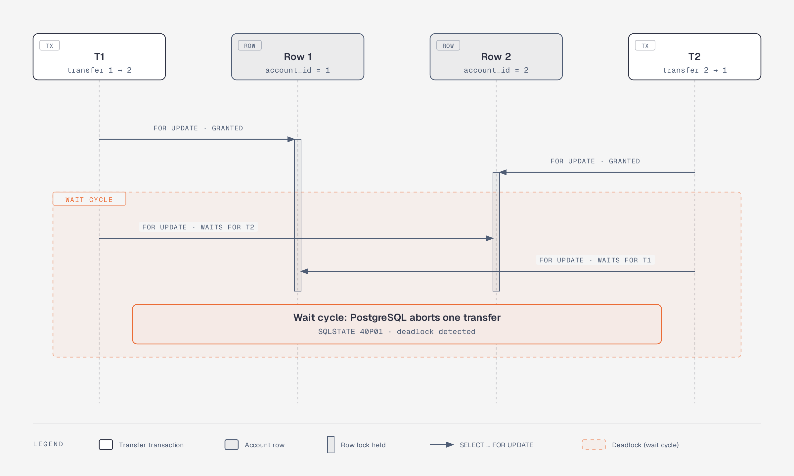
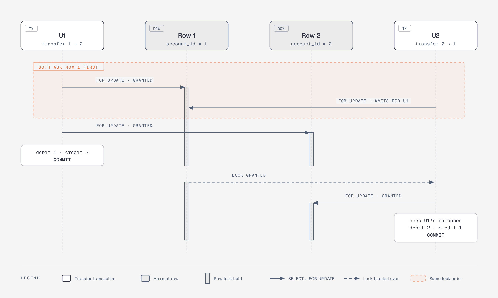

# ADR 0003: Pessimistic row locks taken in ascending account order

Status: accepted

## Context

Concurrent transfers that read a balance and then write it lose updates
(double spending). Locking fixes that, but two transfers A→B and B→A that lock
"source, then destination" wait for each other: a deadlock, which PostgreSQL
resolves by aborting one of them. We measured the options with pgbench before
choosing (see [research/locking-benchmark.md](../research/locking-benchmark.md)).

Locking "source, then destination" can form a wait cycle:



Locking in ascending id order cannot: both transfers ask for row 1 first, so
one waits and both succeed:



## Decision

One database transaction per transfer at `READ COMMITTED`:

```
BEGIN
SELECT account_id, balance FROM accounts
 WHERE account_id = ANY($ids) ORDER BY account_id FOR UPDATE   -- lowest id first
-- missing account → ROLLBACK, 404
-- balance < amount → ROLLBACK, 422 (checked only after the lock is held)
INSERT the ledger row
UPDATE accounts SET balance = balance - amount  (source)
UPDATE accounts SET balance = balance + amount  (destination)
COMMIT
```

- Every transfer locks its two rows in the same global order, so no wait cycle
  can form.
- The balance check runs under the lock; updates are relative.
- `CHECK (balance >= 0)` is a last line of defence if the application check is
  ever bypassed.
- Every statement runs on the transaction's connection; data-access functions
  take `&mut PgConnection`, never the pool.

## Consequences

- Zero deadlocks in the benchmark and in the concurrency tests.
- Transfers touching the same account are serialised; a single very hot
  account limits throughput (documented as a limitation).
- Lock waits are bounded with `lock_timeout` so a stuck holder cannot block
  requests forever ([ADR 0005](0005-retries-and-error-model.md)).

## Alternatives considered

| Approach | Result in benchmark |
|---|---|
| Read, compute in the app, write absolute values | Money created; deadlocks |
| `FOR UPDATE` in request order | Correct totals; most requests deadlock |
| `UPDATE … WHERE balance >= amount`, no ordering | Correct totals; many deadlocks |
| `SERIALIZABLE` with up to 20 retries | Correct totals; still a share of requests failing |
| Advisory locks | Works, but duplicates what row locks already give and is invisible to other clients |
