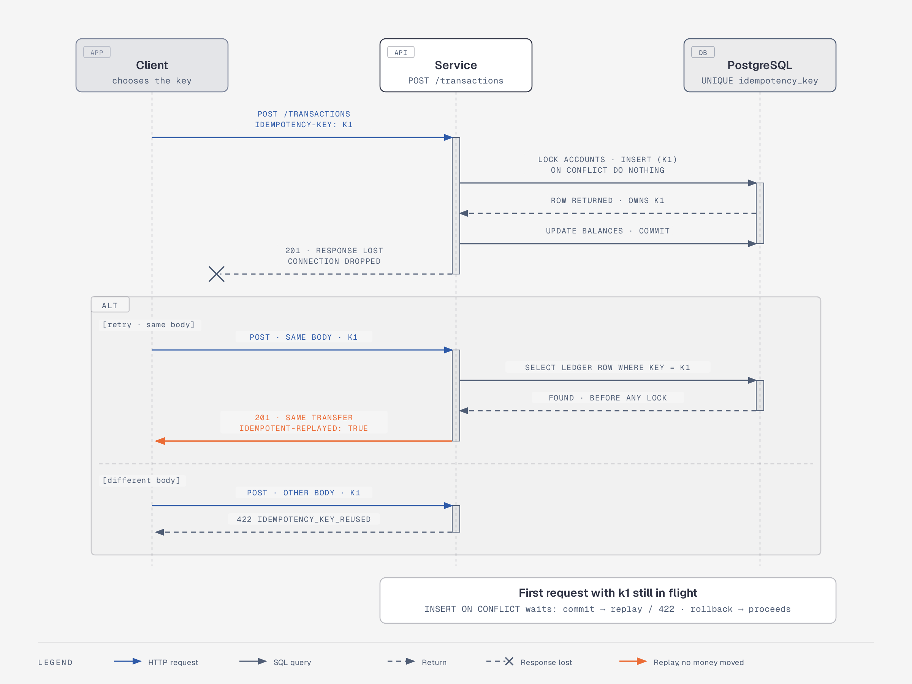

# ADR 0004: Optional Idempotency-Key stored on the ledger row

Status: accepted

## Context

When a connection drops during `COMMIT`, neither the client nor the service
knows whether the transfer happened. Retrying blindly can move money twice;
not retrying can lose a payment. The usual answer is an idempotency key chosen
by the client.

## Decision

- `POST /transactions` accepts an optional `Idempotency-Key` header (1–255
  visible ASCII characters). Optional so that plain requests keep working.
- The key is stored in a `UNIQUE` column on the `transactions` (ledger) row;
  no separate table, no expiry. NULL keys never conflict.
- Inside the transfer transaction, after the accounts are locked and before
  any balance changes, the ledger row is inserted with
  `INSERT … ON CONFLICT (idempotency_key) DO NOTHING RETURNING …`:
  - row returned → this request owns the key, continue;
  - nothing returned → the key already exists: roll back, read the stored
    transfer and return it with `201` and `Idempotent-Replayed: true` if the
    request is identical, or `422 idempotency_key_reused` if it differs.
- If another transaction holding the same key is still in flight, `ON CONFLICT`
  waits for it and then reports the conflict cleanly.

## Consequences

- Concurrent requests with one key move money exactly once.
- Only successful transfers are stored: a request that failed (for example for
  insufficient funds) can be retried with the same key and is evaluated again.
- Keys are global, not scoped to a caller (there is no authentication yet).

## Alternatives considered

- **Plain `INSERT` and catch the unique violation**: the violation aborts the
  transaction, so the original transfer cannot be read in it; replays turned
  into 500s in the benchmark.
- **Separate idempotency table with stored responses and TTL**: more general
  (it can also store failures), but more moving parts than this service needs.
- **Mandatory key**: right for a production payments API; kept optional here to
  keep the basic API simple. Documented as an improvement.
