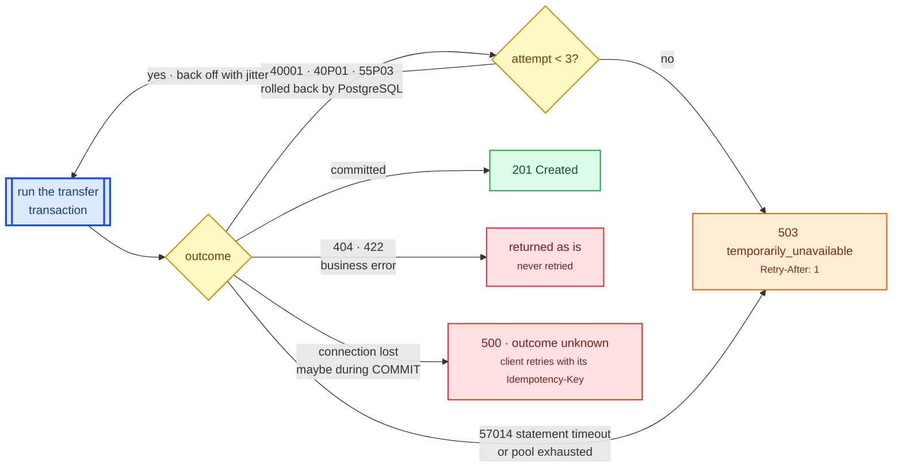

# ADR 0005: Retry only provably rolled-back errors; one JSON error model

Status: accepted

## Context

Even with ordered locking, a transfer can fail transiently (lock timeout under
heavy contention, serialization failure, deadlock if an invariant is ever
broken). Some failures are safe to retry, others are not: a connection lost
during `COMMIT` leaves the outcome unknown. Clients also need errors they can
act on, with stable codes, and no internal details.

## Decision

Retries

- The whole transfer transaction is re-run, up to 3 attempts with jittered
  backoff, only for SQLSTATE `40001` (serialization failure), `40P01`
  (deadlock) and `55P03` (lock not available) — errors after which PostgreSQL
  guarantees the transaction was rolled back. Each retry is logged as a
  warning so a regression is visible.
- Connection errors are never retried in-process; the idempotency key
  ([ADR 0004](0004-idempotency-key.md)) is how a client retries safely.
- `SET LOCAL lock_timeout` bounds each lock wait.

Error model

- One `AppError` enum; each variant maps to a status and a stable `code` in one
  place. Every error body is `{"error": {"code": "...", "message": "..."}}`.
- Extractor rejections (malformed JSON, missing `Content-Type`, bad path
  parameter) are converted to the same JSON shape.
- `400` malformed request, `404` unknown account, `409` duplicate account,
  `415` wrong content type, `422` well-formed but invalid (amount, id, same
  account, insufficient funds, key reuse), `503` busy (with `Retry-After`),
  `500` unexpected. 5xx bodies never contain database or internal details;
  those go to the logs.
- No `unwrap`/`expect`/`panic!` outside tests, enforced by clippy.

## Consequences

- A busy database produces a retryable `503`, not an opaque `500`.
- The worst-case latency of a transfer is bounded by attempts × lock timeout.

## Alternatives considered

- **Retry every database error**: can transfer twice after an ambiguous
  `COMMIT` failure.
- **No retries**: correct, but turns rare transient errors into client-visible
  failures.
- **Problem Details (RFC 9457)**: a reasonable standard; the simpler
  `{error: {code, message}}` shape was enough here.
