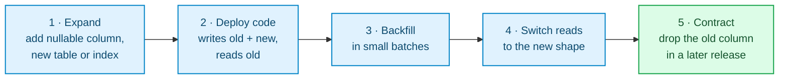

# ADR 0006: Forward-only, zero-downtime schema migrations

Status: accepted

## Context

Migrations are plain SQL files in `migrations/`, embedded in the binary by
`sqlx::migrate!` and applied on startup or by `internal-transfers migrate`.
sqlx records each applied version with a checksum in `_sqlx_migrations` and
refuses to start if an applied file was edited. Two risks remain:

- A DDL statement waiting for a lock on `accounts` or `transactions` queues
  every transfer behind it, so a "small" migration can stop the service.
- A down migration that drops a column or table can destroy ledger data, which
  must never be lost.

## Decision

- **Forward only.** No `.down.sql` files. A bad migration is fixed by a new
  migration; a release is rolled back by deploying the previous binary, which
  must still work with the new schema (see expand/contract).
- **Append only.** Never edit or rename an applied file. Create a new one with
  `make migration name=<what_it_does>` (next 4-digit version, template below).
- **Bounded lock waits.** Every migration starts with
  `SET LOCAL lock_timeout = '5s'`; if the table is busy the migration fails
  fast and is retried, instead of blocking traffic.
- **Indexes on existing tables** use `CREATE INDEX CONCURRENTLY` in a file whose
  first line is `-- no-transaction` (sqlx runs it outside a transaction).
- **Constraints on existing tables** are added `NOT VALID` (new writes are
  checked, existing rows are not scanned, the lock is brief) and validated in a
  later migration with `VALIDATE CONSTRAINT`, which does not block reads or
  writes. A plain `ADD CONSTRAINT … CHECK` holds an exclusive lock for a full
  scan and fails the deploy if any old row violates it (`0002` follows this).
- **Expand / contract** for anything that changes the shape clients or the
  previous binary rely on:

- **Separate role in production.** `internal-transfers migrate` runs as a role
  that owns the schema; the service runs with `RUN_MIGRATIONS=false` as a role
  limited to DML. Locally one user does both.

## Consequences

- Every release is safe to roll back by redeploying the previous image.
- Ledger data is never dropped by tooling.
- Changes take more steps (expand/contract spans two releases).
- Most tests apply all migrations to an empty database. Upgrades of a database
  that already holds data are covered in `tests/api/migrations.rs`: it stops at
  an older version (`MIGRATOR.run_to`), writes rows the old schema allowed, then
  upgrades. Every migration that adds a constraint gets such a test.

## Alternatives considered

| Option | Why not |
|---|---|
| Reversible `.up.sql` / `.down.sql` pairs | Down steps on a ledger are dangerous and rarely exercised |
| Migrate only on startup | Couples schema changes to every instance start; no separate privileges |
| External tool (Flyway, Atlas) | Extra runtime dependency; sqlx already gives versioning, checksums and locking |
