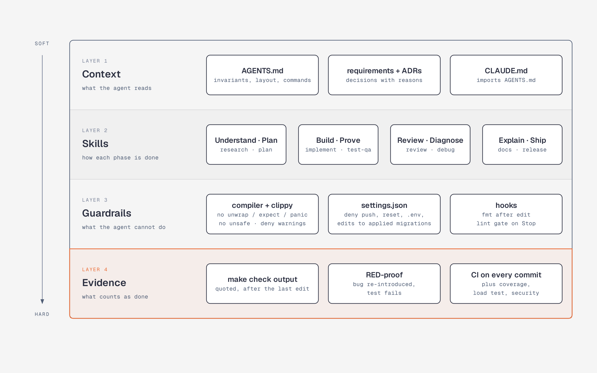

# AI-assisted delivery

This service was built with an AI coding agent (Claude Code) doing most of the
typing, and an engineer owning everything that decides whether money is safe:
the requirements, the invariants, the decisions, the harness the agent works
inside, and the review. This page explains that setup, because it is how the
code should keep being changed.

The rule behind all of it: **an agent's claim is not evidence.** Every
statement that something works is backed by a command whose output anyone can
reproduce, and every guard test has been shown to fail without its fix.

## Who does what

| Activity | Engineer | Agent |
|---|---|---|
| Read the brief, rank what must never go wrong | owns | - |
| Open questions → recorded defaults ([requirements](requirements.md)) | decides | drafts options and consequences |
| Failure catalogue and test plan ([pitfalls](research/pitfalls-and-test-plan.md)) | reviews, adds cases | researches known transfer bugs |
| Locking strategy ([benchmark](research/locking-benchmark.md), [ADR 0003](adr/0003-ordered-row-locking.md)) | chooses from the numbers | writes and runs the 7 pgbench variants |
| Plan in green commits ([plan](plan.md)) | approves scope and order | splits tasks, names the test for each |
| Code and tests | reviews every diff | writes them test-first (`implement`, `test-qa`) |
| Independent review | triages findings, decides | fresh session, read-only, `review` skill |
| Harness: AGENTS.md, skills, settings, hooks, CI gates | designs and maintains | follows; proposes changes as PRs |
| Commit, tag, push, deploy | only the engineer | denied by settings |

## The harness

An agent is as good as the context it reads and the gates it cannot skip.
The harness has four layers, from soft to hard.

### 1. Context

- [`AGENTS.md`](../AGENTS.md) is the contract: the invariants that must never
  break (ordered `FOR UPDATE`, relative updates, append-only ledger, no float
  money, which SQLSTATEs may be retried), where code goes, and the exact
  commands. It is written for a reader with no memory of earlier sessions.
- Requirements and ADRs record *why*, so an agent does not "simplify" a
  decision away. A change that contradicts an ADR needs a new ADR first.

### 2. Skills, one per phase

Each skill in [`.claude/skills/`](../.claude/skills/) names this repository's
files, functions and error codes, so it works as a checklist rather than
generic advice.

| Phase | Skill | Gate before moving on |
|---|---|---|
| Understand | `research` | a measurement or a source for each claim; an ADR for each decision |
| Plan | `plan` | every task has its test named; every commit stays green |
| Build | `implement` | test written and seen failing first; `make check` output quoted |
| Prove | `test-qa` | the test is RED-proven against the exact regression it guards |
| Review | `review` | a different session, given the code and not the author's reasoning |
| Diagnose | `debug` | root cause found before any fix; three failed attempts → stop and escalate |
| Explain | `docs` | README, OpenAPI, ADRs and CHANGELOG updated in the same commit |
| Ship | `release` | every commit in the range passes CI on its own |

### 3. Guardrails that do not depend on the agent's judgement

| Guardrail | Enforced by |
|---|---|
| No `unwrap`, `expect`, `panic!` on the request path; no `unsafe` | `#![deny(clippy::unwrap_used, ...)]` in `lib.rs`, `unsafe_code = "forbid"` |
| No warnings of any kind | `[lints.clippy] all = "deny"`, CI `-D warnings` |
| A new error variant is handled everywhere | exhaustive `match` without `_` (AGENTS.md *Rust style*) |
| Same toolchain for agent, human, CI and Docker | `rust-toolchain.toml` |
| Applied migrations are never edited | `.claude/settings.json` denies `Edit` on them; sqlx checksums them at startup |
| Secrets are never read | `settings.json` denies `Read(./.env)` and `Read(./deploy/.env)` |
| History and remote are never rewritten by the agent | `git push`, `reset --hard`, `checkout --`, `clean` denied; `commit` asks |
| Formatting never drifts | `PostToolUse` hook runs `cargo fmt` after every edit |
| A turn cannot end with a red lint | `Stop` hook [`lint-gate.sh`](../.claude/hooks/lint-gate.sh) runs fmt + clippy and sends failures back to the agent |
| Nothing broken lands, even mid-branch | CI `every-commit` builds, tests and starts every commit of a push |

### 4. Evidence

- **Real PostgreSQL, no mocks.** Failure modes (held locks, exhausted pool,
  statement timeout, client disconnect) are produced for real.
- **RED-proof.** Each guard test was run against its bug: request-order
  locking, no `FOR UPDATE`, a plain `INSERT` for the idempotency key, no
  retry, no `tokio::spawn`, a blocking constraint, no output normalisation,
  one decimal place too many. A test that cannot fail proves nothing.
- **Properties, not just examples.** `proptest` checks the money parser on
  thousands of generated inputs: everything the grammar allows round-trips
  exactly, anything else is rejected without a panic, nothing is rounded.
- **From the outside.** A k6 load test runs the release image under
  concurrent HTTP traffic in CI and checks conservation of money, no negative
  balance, no 5xx and single-execution replays ([loadtest](../loadtest/README.md)).

## Reviewing AI-written code

Agent code tends to be plausible, well formatted and confidently explained,
so review targets what plausibility hides. In order:

1. **Tests first.** Does the test fail without the change? Does it assert
   state (balances, ledger count, totals), not only a status code? Are
   expected values literals rather than computed with production code?
2. **Verify the verification.** Re-run `make check` or read the CI run; do
   not accept "tests pass" from the author, human or agent.
3. **Then the code, against the invariants.** The red flags this repository
   rejects on sight (from the `implement` skill):
   - reading a balance and writing an absolute value back;
   - any query on the pool inside the transfer transaction;
   - `f64`, `.round`, `with_scale` anywhere near money;
   - retrying an error PostgreSQL did not roll back (a lost `COMMIT`);
   - `_ =>` on our own enums, `#[allow]` instead of `#[expect(reason)]`;
   - speculative settings, options or abstractions nobody asked for.
4. **Each finding is verified against the code** before it is acted on, and
   fixed together with a test that fails without the fix. A wrong finding gets
   a `file:line` reply, not a change.

What the independent review rounds caught, and how each was closed:

| Finding | Closed by |
|---|---|
| A busy database answered `500` | SQLSTATE classification → `503` + `Retry-After`; tests for lock held, statement timeout, exhausted pool |
| A replay could wait behind, or fail on, locks of unrelated transfers | key looked up before any lock; test with a lock held on the accounts |
| Concurrency tests ran on a 5-connection pool, so little really overlapped | dedicated 16-connection pool in `concurrency.rs` |
| No upper bound on balances | 10^20 limit under the lock, `NOT VALID` constraint, upgrade test with existing data |
| Lock-dependent tests relied on sleeps | tests wait on `pg_stat_activity` instead |
| MSRV stated lower than a dependency requires | corrected to 1.94; toolchain pinned for everyone |

## Why the language is not the bottleneck

With an agent writing the code, the scarce skills are deciding what must be
true, designing so it stays true under concurrency and failure, and checking
that it is true. Rust helps with the third: the type system, `Money` and
`AccountId` that cannot hold invalid values, exhaustive matches and a strict
clippy configuration act as a second reviewer on every edit, before a human
reads a line. The engineer's review then concentrates on behaviour: locking
order, transaction boundaries, retry safety, and what happens when the
connection drops.

## Try the harness

Open the repository in Claude Code and:

- ask it to change `migrations/0001_*.sql`: the edit is denied (ADR 0006);
- ask it to add a helper that calls `.unwrap()` in `src/`: the Stop hook
  rejects the turn with the clippy error until it is fixed;
- ask for a review of a commit range: the `review` skill runs read-only and reports findings with `file:line` and a failure scenario;
- ask "is it done?": the `implement` skill requires quoted `make check` output.
