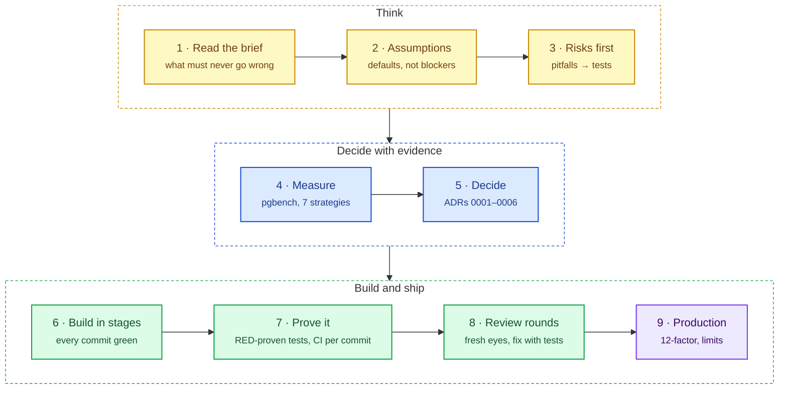

# Engineering approach

The reasoning behind the code, in the order the work was done, for a technical
conversation about it. Each entry points to where the evidence lives.

## Engineering timeline

Each activity, the reasoning behind it, and its outcome. The sections after
this table go deeper into the main ones.

| # | Activity | Reasoning | Outcome |
|---|---|---|---|
| 1 | Read the brief, sketched the flow of each endpoint | Three endpoints are easy; the risk is all in "transfer" under concurrency. What must never go wrong? | Priorities: no money created or lost, atomic, never negative, auditable |
| 2 | Listed what the brief leaves open | Which of these block me, and which can get a sensible default I can change later? | Defaults with reasons in [requirements](requirements.md); none blocked the work |
| 3 | Questioned whether idempotency is in scope | A client that times out will retry; without a key it pays twice. Payment APIs treat this as standard | Optional `Idempotency-Key`, [ADR 0004](adr/0004-idempotency-key.md) |
| 4 | Researched the classic mistakes in transfer code | If I can name how it breaks, I can write the test before the code | [Pitfalls catalogue and test plan](research/pitfalls-and-test-plan.md): every pitfall has a guard and a test |
| 5 | Worked through retry and rollback | Which errors are safe to retry? Only those after which PostgreSQL guarantees a rollback; a lost `COMMIT` is not one of them | [ADR 0005](adr/0005-retries-and-error-model.md) |
| 6 | Measured the locking options with pgbench | Several designs "should" work; numbers decide, not opinions | Ordered `FOR UPDATE` the only one with 0 % failures and correct totals ([benchmark](research/locking-benchmark.md)) |
| 7 | Asked how it deploys, scales and is maintained | Stateless service, all coordination in PostgreSQL; where is the ceiling? | Limits written down: hot accounts, connection budget, sharding needs a saga |
| 8 | Turned research into a checklist and a staged plan | Small tasks, each with its test, in an order where every commit works | [Delivery plan](plan.md) |
| 9 | Chose the project layout and strict lints | HTTP, domain and SQL in separate layers; the compiler should reject `unwrap` and float money for me | `routes/` · `domain/` · `db/`; clippy denies warnings, no `unwrap` outside tests |
| 10 | Implemented test-first | Each guard test must fail when its bug is put back, otherwise it proves nothing | Integration tests on a real database; every guard test RED-proven |
| 11 | Wrote an explainer with diagrams | If I cannot draw the transfer, I cannot defend it | [Architecture](architecture.md) with flow, sequence and schema diagrams |
| 12 | First independent review | Someone without my reasoning will see what I stopped seeing | Busy database → `503` instead of `500`; statement timeout; best-effort rollback |
| 13 | Second independent review | Do the tests really exercise what they claim? | MSRV fixed; concurrency tests on a 16-connection pool; replays answered before taking locks; benchmark made reproducible |
| 14 | Re-read the brief as the grader would | Clone it fresh and run every example from the README, exactly as written | Clearer negative-amount error; setup without `make` documented |
| 15 | Added API docs generated from the code | Hand-written docs drift; a test can stop that | OpenAPI + reference page at `/docs`, tested against the router |
| 16 | Production pass against twelve-factor | Would this survive a real deployment, not just a demo? | Validated config with the password redacted, TLS, `/ready`, request ids, JSON logs, `migrate` release step, pinned images |
| 17 | Reorganised the work as a delivery pipeline | Several of those items were setup that should have come first; doing setup first avoids rework | Stages S0 → S7; every commit green and checked by CI one by one; CHANGELOG grows per commit |
| 18 | Wrote the contributor guide and project skills | The next person (or agent) should work the same way without asking me | `AGENTS.md`, `.claude/skills/` (research, plan, implement, test-qa, review, debug, docs, release) |
| 19 | Set the migration policy and drew the remaining diagrams | Schema changes on a money table must never block transfers or fail on existing data | [ADR 0006](adr/0006-forward-only-migrations.md): forward-only, `NOT VALID` constraints, upgrade tests |
| 20 | Third review on the latest changes | A new constraint can break an upgrade of existing data; sleeps make tests flaky | Balance limit added `NOT VALID` with an upgrade test; lock tests wait on PostgreSQL state |
| 21 | Final check from an empty directory | Trust the result only after running it the way a newcomer would | Clone → `docker compose up` → README examples → `make check` → benchmark, all green |

## 1. Read the brief for what must never go wrong

Three endpoints look simple; the hard part is the word *transfer*. In order of
priority:

1. **No money created or lost**, even with many transfers on the same accounts
   at once, including A→B and B→A together.
2. **Atomic**: debit, credit and the ledger row commit together or not at all.
3. **No negative balance**, ever.
4. **Auditable**: an immutable history that reconciles every balance.

Everything else (API shape, docs, ops) comes after these. A smaller correct
service beats a bigger one with a hole in it, so scope was cut, not
correctness ([requirements](requirements.md) → *Out of scope*).

## 2. Turn open questions into recorded defaults

The brief leaves real decisions open. Instead of blocking on them I picked a
default for each, wrote down why, and kept it easy to change
([requirements](requirements.md) → *Assumptions and defaults*). On a real
project these are confirmed with the product owner first; precision and limits
are business rules, not technical ones.

| Question | Default | Why |
|---|---|---|
| Amount format | JSON **string**, up to 20 integer + 18 decimal digits, never rounded | A JSON number may already have lost precision as a float |
| Idempotency | Optional `Idempotency-Key` header | A transfer API must survive a client retry after a timeout without paying twice |
| Maximum balance | Below 10^20 | Keeps every balance inside the digits clients are told to expect |
| Same-account transfer | Rejected (`422 same_account`) | Changes nothing, usually a client bug |
| Busy database | `503` + `Retry-After`, not `500` | Tells the client the request is safe to retry |

## 3. List the ways it can break before writing code

I wrote the failure catalogue first and gave every entry a guard and a test
([pitfalls and test plan](research/pitfalls-and-test-plan.md)). The ones that
shaped the design:

| Failure | Guard |
|---|---|
| Lost update / double spend (read balance, write absolute value) | Row lock, check after locking, relative `UPDATE balance = balance ± amount` |
| Deadlock on A→B and B→A | Lock both rows in ascending id order |
| Float rounding | `BigDecimal` + unconstrained `NUMERIC`; strings on the wire |
| Duplicate transfer on retry | Idempotency key claimed with `INSERT … ON CONFLICT DO NOTHING` before money moves |
| Half-committed transfer | One database transaction; client disconnect cannot cancel it (`tokio::spawn`) |
| Unbounded waits | `lock_timeout` 2 s, `statement_timeout` 10 s, pool acquire timeout |
| Negative balance if the app check is bypassed | `CHECK (balance >= 0)` in the database as a backstop |
| History edited after the fact | Triggers reject `UPDATE`, `DELETE`, `TRUNCATE` on the ledger |

## 4. Measure instead of arguing

Several locking designs "should work". I ran them with `pgbench` (16 clients,
both directions, 4 accounts) before choosing
([benchmark](research/locking-benchmark.md), reproducible with `bench/run.sh`):

| Strategy | Failed requests | Money afterwards (correct: 400) |
|---|---|---|
| Read, compute in app, write absolute value | 52–61 % | **981–1051: money created** |
| `FOR UPDATE` in request order | 75–78 % (deadlocks) | 400 |
| Conditional `UPDATE … WHERE balance >= amount` | 44–52 % (deadlocks) | 400 |
| `SERIALIZABLE` with 20 retries | 8–11 % | 400 |
| **`FOR UPDATE` in ascending id order** | **0 %** | **400** |

The same harness showed why the idempotency key is claimed with `ON CONFLICT`:
a plain `INSERT` on a duplicate key aborts the whole transaction (23505 → 25P02),
which turned replays into 500s.

## 5. Record each decision once

Every decision someone might later re-argue is an ADR with the alternatives
that lost ([`adr/`](adr/)):

| ADR | Decision | Main trade-off accepted |
|---|---|---|
| [0001](adr/0001-stack-axum-sqlx-postgres.md) | axum + sqlx + PostgreSQL | Runtime-checked queries (builds without a database) over compile-time checks |
| [0002](adr/0002-money-as-decimal-strings.md) | Money as decimal strings, `BigDecimal`, no rounding | Clients must send strings |
| [0003](adr/0003-ordered-row-locking.md) | READ COMMITTED + ordered `FOR UPDATE` | A very hot account serialises its transfers |
| [0004](adr/0004-idempotency-key.md) | Key stored on the ledger row, claimed with `ON CONFLICT` | Only successful transfers are remembered; keys are global |
| [0005](adr/0005-retries-and-error-model.md) | Retry only errors PostgreSQL rolled back (40001, 40P01, 55P03); one JSON error model | A lost `COMMIT` is not retried by the server; the client retries with its key |
| [0006](adr/0006-forward-only-migrations.md) | Forward-only, non-blocking migrations | Shape changes take two releases (expand / contract) |

## 6. Build in stages, every commit green

The [delivery plan](plan.md) runs S0 setup → S1 requirements → S2 research and
design → S3 build → S4 review fixes → S5 production readiness → S6 CI → S7
docs and release. Setup (lints, config, logging, probes, Docker, CI) comes
first so later work never has to retrofit it. Every commit builds, passes the
tests and starts on its own; CI checks each commit, not only the last one, so
`git bisect` and reverts always land on working code. The
[CHANGELOG](../CHANGELOG.md) grows with each commit.

## 7. Prove it, don't assume it

- **Real database, no mocks.** 63 integration tests go through the real router
  against PostgreSQL, each with its own fresh database; failure modes (held
  locks, exhausted pool, statement timeout, unreachable database) are produced
  for real.
- **Concurrency tests check invariants**, not just status codes: 100 A→B with
  100 B→A, 10 concurrent overdrafts of which exactly 3 succeed, 400 random
  transfers after which the total is unchanged, no balance is negative and
  every account reconciles with its history.
- **Every guard test is RED-proven**: I reintroduced the exact bug (request-order
  locking, no `FOR UPDATE`, plain `INSERT` for the key, no retry, no
  `tokio::spawn`, a blocking constraint) and watched that test fail.
- **No timing luck**: tests that depend on a lock wait poll PostgreSQL
  (`pg_stat_activity`) instead of sleeping.
- **Fresh-clone check**: clone, `docker compose up`, the README's own curl
  commands, `make check`, the benchmark - all from an empty directory.

## 8. Review with fresh eyes, fix with tests

Independent reviews read the code without my reasoning. Each finding was
verified against the code first, then fixed together with a test that fails
without the fix. What they caught:

| Finding | Fix |
|---|---|
| A busy database answered `500` | Classified by SQLSTATE → `503` + `Retry-After` |
| A replay could wait behind locks or see a drained balance | Look the key up before taking any lock |
| Concurrency tests ran on a 5-connection pool, so little really overlapped | Dedicated 16-connection pool |
| No upper bound on balances | Limit 10^20, checked under the lock, with a `NOT VALID` constraint so upgrading existing data cannot fail |
| Two tests depended on sleeps | Wait on the database state instead |

## 9. Think about running it, not only passing tests

- Twelve-factor configuration from the environment, validated at startup, the
  database password redacted from logs; TLS via `sslmode`.
- `/health` (process up) separate from `/ready` (database reachable).
- Graceful shutdown drains in-flight requests; request ids on every log line;
  JSON logs on demand.
- Migrations can run as a release step (`internal-transfers migrate`,
  `RUN_MIGRATIONS=false`) and never block traffic (ADR 0006).
- Known limits are written down rather than hidden (README → *Limitations*):
  hot accounts, global idempotency keys, connection budget per instance,
  sharding would need a saga, a double-entry ledger would be the
  accounting-standard model.

## Likely questions, short answers

| Question | Answer |
|---|---|
| Why not `SERIALIZABLE`? | Measured: it still failed 8–11 % of transfers after 20 retries; ordered row locks failed none and are simpler to reason about |
| How do you prevent deadlocks? | Every transfer locks its two accounts lowest id first, so no wait cycle can form; retries remain as a safety net |
| What if the connection drops during `COMMIT`? | The outcome is unknown, so the server does not retry; the client resends with the same `Idempotency-Key` and gets the original transfer back |
| Why strings for amounts? | Floats cannot represent most decimals exactly; a JSON number may already be rounded before the server sees it |
| How would it scale? | Stateless service, scale horizontally; the limit is one hot account's row lock. Next: sub-accounts or batching for hot accounts, read replicas for balances, ledger partitioning, sharding by account with a saga for cross-shard transfers |
| How do you know the tests are not passing by luck? | Each guard test was shown to fail with its bug reintroduced; concurrency tests assert invariants; lock-dependent tests wait on PostgreSQL state, not sleeps |
| What would you add next? | Mandatory, client-scoped idempotency keys that also store failures; metrics; a per-request deadline; static analysis (CodeQL) in CI |
