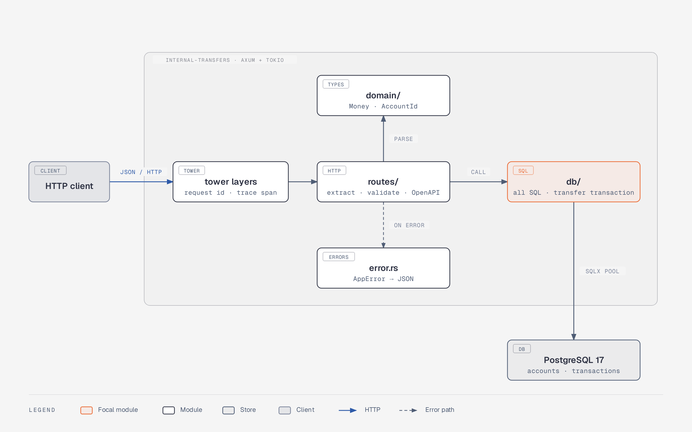
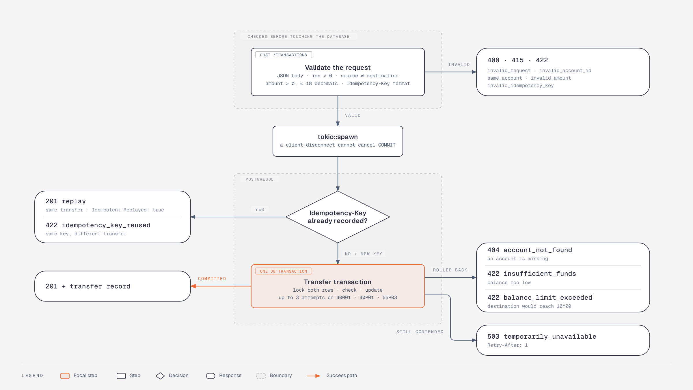
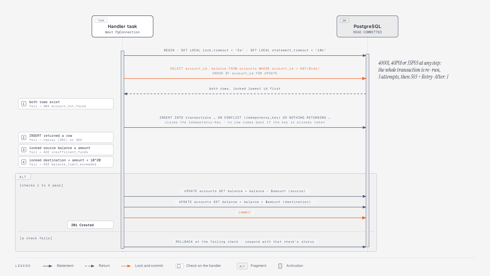
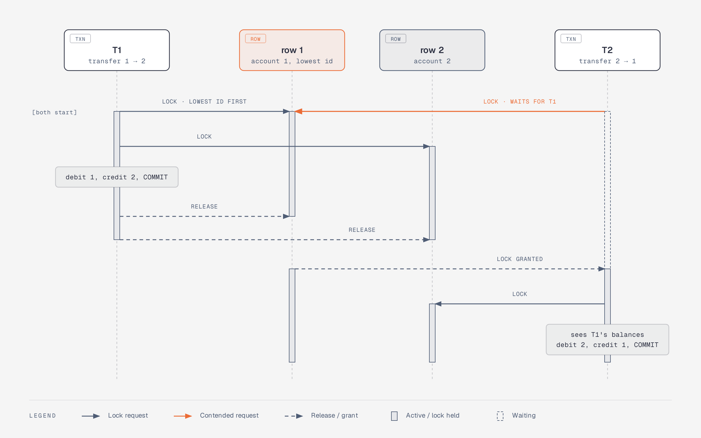
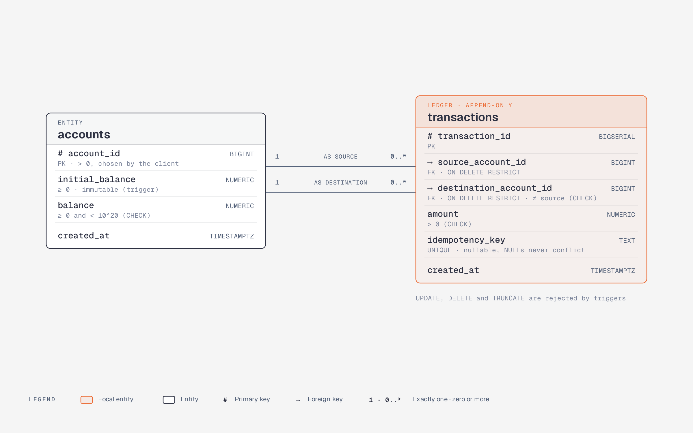

# Architecture

How the service is put together and how a request flows through it. The
*why* behind each decision is in the [ADRs](adr/); this page describes the
*what*.

## Components

`config.rs` turns the environment into a typed `Config` at startup and
`startup.rs` wires the pool, migrations, server and graceful shutdown.

| Module | Responsibility | Depends on |
|---|---|---|
| `main.rs` | Parse config, init logging, dispatch `serve` / `migrate` | `config`, `startup` |
| `startup.rs` | Connection pool (TLS via URL), migrations, server, SIGTERM/Ctrl-C drain | `routes` |
| `config.rs` | Environment variables → `Config`; password redacted in `Debug` | — |
| `routes/` | HTTP shapes, extractors, OpenAPI annotations; no SQL | `domain`, `db`, `error` |
| `domain/` | `Money` (strict decimal strings), `AccountId` (positive i64) | `bigdecimal` |
| `db/` | SQL, SQLSTATE classification (retryable / busy), transfer algorithm | `domain`, `error` |
| `error.rs` | One error enum, one status/code table, no internals in 5xx | `domain`, `db` |

The library (`lib.rs`) exposes everything; the binary is a thin wrapper, so the
integration tests build exactly the router that production runs.

## Request flow: `POST /transactions`

Everything above the dashed line is checked without touching the database.

The response always carries `X-Request-Id` (the caller's value or a new UUID).

## Transfer transaction

`src/db/transfers.rs`, one transaction at `READ COMMITTED`:

| Step | SQL | On failure |
|---|---|---|
| 1 | `BEGIN; SET LOCAL lock_timeout = '2s'; SET LOCAL statement_timeout = '10s'` | — |
| 2 | `SELECT account_id, balance FROM accounts WHERE account_id = ANY($ids) ORDER BY account_id FOR UPDATE` | lock timeout → retry, then 503 |
| 3 | Both rows present? | `ROLLBACK`, 404 `account_not_found` |
| 4 | `INSERT INTO transactions … ON CONFLICT (idempotency_key) DO NOTHING RETURNING …` | no row → `ROLLBACK`, replay or 422 |
| 5 | `balance >= amount` (source) and `balance + amount < 10^20` (destination), read under the lock | `ROLLBACK`, 422 `insufficient_funds` / `balance_limit_exceeded` |
| 6 | `UPDATE accounts SET balance = balance - $amount` (source), `+ $amount` (destination) | `CHECK (balance >= 0)` and `CHECK (balance < 1e20)` as backstops |
| 7 | `COMMIT` | connection error → not retried; client retries with its key |

Locks are always taken lowest id first, so transfers in opposite directions
cannot deadlock ([ADR 0003](adr/0003-ordered-row-locking.md)). Every statement
runs on the transaction's connection; functions in `transfers.rs` take
`&mut PgConnection`, never the pool.

Two opposite transfers at the same moment, A = account 1, B = account 2:

Both transfers ask for row 1 first, so one simply waits for the other: no
cycle, no deadlock, and the second sees the first one's result.

Error classification (`db/mod.rs`):

| SQLSTATE / error | Meaning | Handling |
|---|---|---|
| `40001`, `40P01`, `55P03` | Rolled back by PostgreSQL | Re-run the transaction (3 attempts), then 503 |
| `57014`, pool acquire timeout | Busy | 503 + `Retry-After: 1`, not retried in-process |
| `23505` on `accounts` | Duplicate id | 409 `account_already_exists` |
| anything else | Unexpected | 500, details only in logs |

## Schema

- Triggers reject `UPDATE`, `DELETE` and `TRUNCATE` on `transactions`, and any
  change of `accounts.initial_balance`.
- Amount columns are unconstrained `NUMERIC`: `NUMERIC(p, s)` would round.
- Indexes on both account columns of `transactions` keep reconciliation cheap.
- Invariant, checked by tests:
  `balance = initial_balance + Σ incoming − Σ outgoing` for every account.

## Runtime and deployment

| Concern | How |
|---|---|
| Configuration | Environment only (`DATABASE_URL`, `BIND_ADDR`, `DB_MAX_CONNECTIONS`, `DB_ACQUIRE_TIMEOUT_SECS`, `RUN_MIGRATIONS`, `LOG_FORMAT`, `RUST_LOG`) |
| Migrations | Embedded; applied on startup (advisory lock) or as `internal-transfers migrate` |
| Probes | `/health` liveness (no DB), `/ready` readiness (DB ping) |
| Logs | stdout, text or JSON, request id on every request span |
| Shutdown | SIGTERM → stop accepting, drain in-flight requests, close pool |
| Image | Pinned multi-stage build, non-root user, exec-form `CMD` |
| Scaling | Stateless; all coordination in PostgreSQL. Budget: `instances × DB_MAX_CONNECTIONS < max_connections` |
