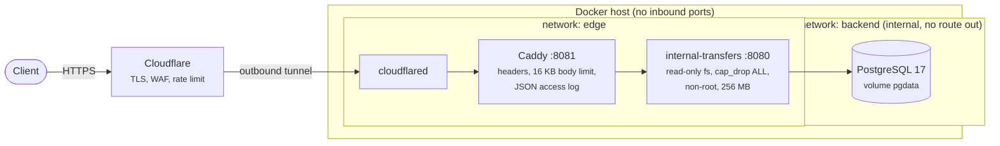
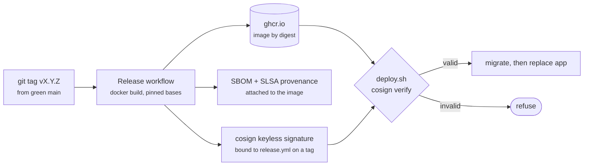

# Deployment

How a released version gets from a git tag to a public URL, and the controls
on the way. Everything here is code in the repository: `.github/workflows/release.yml`,
`deploy/compose.yml`, `deploy/Caddyfile`, `deploy/deploy.sh`.

The brief needs one instance and one database, so the target is a single
Linux host with Docker. The same image and release step move unchanged to
Kubernetes or a managed container service (notes at the end).

## Topology



- **No open port on the host.** `cloudflared` dials out to Cloudflare; the
  origin IP is never published and nothing listens on the public interface.
- **The database cannot be reached from outside the host, and has no way out.**
  It lives on an `internal` network that only the app and the migration job join.
- **Hardened containers.** App, migration job, Caddy and cloudflared run with
  a read-only root filesystem, all Linux capabilities dropped (Caddy keeps
  `NET_BIND_SERVICE` only) and `no-new-privileges`. The app runs as uid 10001
  with memory, CPU and PID limits.

## Supply chain: from tag to running image



| Control | Where |
|---|---|
| Actions pinned to commit SHAs, read-only `GITHUB_TOKEN` by default, no persisted git credentials | all workflows; linted by `zizmor` in `security.yml` |
| Base and service images pinned by tag **and** digest; Dependabot proposes updates | `Dockerfile`, `docker-compose.yml`, `deploy/compose.yml`, CI services |
| Dependencies: RustSec advisories, licenses, registries | `cargo deny` (`deny.toml`), every push and weekly |
| Code: static analysis | CodeQL (`security-and-quality`) |
| Secrets in history | gitleaks over the whole history |
| Runtime image CVEs | Trivy, HIGH/CRITICAL with a fix fails the build |
| What is in the image, and how it was built | SBOM and `mode=max` provenance from BuildKit, plus a GitHub build-provenance attestation |
| Only images built by this repo's release workflow can run | keyless cosign signature, verified by `deploy.sh` against the workflow identity and the GitHub OIDC issuer |
| Deploys reference immutable digests, never tags | `deploy.sh` rejects a ref without `@sha256:` |

## First-time setup

1. **Host.** Any small Linux VM with Docker Engine + Compose v2, `cosign` and
   `curl`. No firewall rule is needed beyond outbound HTTPS.
2. **Tunnel and DNS.** In Cloudflare Zero Trust, create a tunnel, add the
   public hostname `transfers.<your-domain>` with service `http://caddy:8081`,
   and copy the tunnel token. Cloudflare creates the DNS record.
3. **Edge rules (Cloudflare dashboard).** A rate-limiting rule on
   `POST /accounts` and `POST /transactions` (for example 60 requests per
   10 s per IP, then block for 60 s), and *Always Use HTTPS*. The brief has no
   authentication, so the public demo relies on these limits.
4. **Image visibility.** After the first release, set the GHCR package to
   public (or `docker login ghcr.io` on the host).
5. **Configuration.** On the host, in a checkout of the repository:
   `cp deploy/.env.example deploy/.env`, then fill in `DOMAIN`,
   `POSTGRES_PASSWORD` (`openssl rand -hex 24`) and `TUNNEL_TOKEN`.
   `deploy/.env` is git-ignored and the agent harness denies reading it.

## Releasing and deploying

```bash
# on a workstation, from green main
git tag -s v0.2.0 -m "v0.2.0" && git push origin v0.2.0
# the Release run summary prints the digest; on the host:
deploy/deploy.sh ghcr.io/<owner>/internal-transfers-rs@sha256:<digest>
```

`deploy.sh` stops at the first failing step:

1. verifies the signature (only `release.yml` on a `v*` tag of this repository);
2. records the previous digest and writes the new one to `deploy/.env`;
3. pulls, then runs migrations as a separate release step
   (`internal-transfers migrate`); the app runs with `RUN_MIGRATIONS=false`;
4. replaces the app; the old container gets SIGTERM and drains in-flight
   requests within `stop_grace_period: 30s`;
5. smoke-tests `https://<domain>/ready` and `/docs` through Cloudflare, and
   prints the rollback command.

After a deploy, a short HTTP load test against the public URL confirms the
invariants end to end:

```bash
BASE_URL=https://transfers.<your-domain> P95_MS=800 k6 run loadtest/transfers.js
```

## Rollback

Run `deploy.sh` with the previous digest it printed. Migrations are
forward-only and additive ([ADR 0006](adr/0006-forward-only-migrations.md)),
so the previous binary keeps working on the newer schema and a rollback never
needs a down-migration.

## Operating it

| Need | How |
|---|---|
| Logs | `docker compose -f deploy/compose.yml logs -f app caddy`: JSON lines, every request carries `x-request-id` |
| Health | `/health` (process up) and `/ready` (database reachable); Caddy routes only while `/ready` passes |
| Reconcile balances against history | the SQL in the README (*Schema*), via `docker compose exec db psql -U transfers` |
| Backups | `docker compose exec db pg_dump -U transfers transfers > backup.sql`; for real money: managed PostgreSQL with point-in-time recovery |

## Beyond one host

The image, the `migrate` release step, the probes and the SIGTERM drain map
directly to Kubernetes: a `Job` (or Argo CD `PreSync` hook) for migrations, a
`Deployment` with `/health` as liveness and `/ready` as readiness probes,
`terminationGracePeriodSeconds: 30`, a `NetworkPolicy` that only lets the app
reach PostgreSQL, admission policy that requires the cosign signature, and
managed PostgreSQL. More than one instance is safe because all coordination is
in PostgreSQL; keep `instances × DB_MAX_CONNECTIONS` below `max_connections`.
